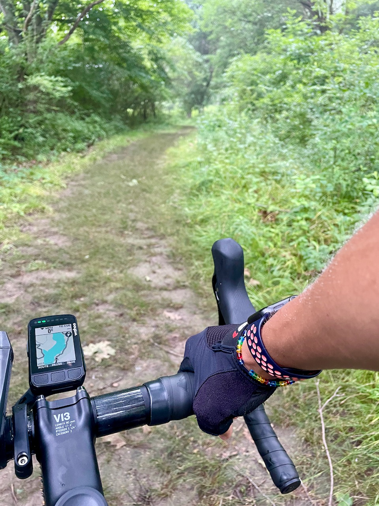

<!--  -->

¡Hola, soy Juan! Me encanta aprender sobre todo, probar cosas nuevas y vivir aventuras. He incursionado en muchas áreas y pasatiempos a lo largo de los años, adquiriendo una amplia gama de habilidades en cosas como ciencia de datos, enseñanza, diseño gráfico, idiomas extranjeros, [programación](https://github.com/juandpinto), edición, fotografía, lo que sea.

Pero ante todo, soy un hombre de familia 🧔🏾‍♂️👱🏼‍♀️🧑🏽👧🏽👦🏽🐈🐈‍⬛. También soy apasionado por el potencial de usar la tecnología de manera efectiva para aumentar el acceso a la educación de alta calidad en todo el mundo. Este interés me ha llevado a mi puesto actual como científico de datos en el sector de la tecnología educativa, donde trabajo en la apasionante intersección de la inteligencia artificial y la educación. Tengo un doctorado de la Universidad de Illinois Urbana-Champaign.



Soy originario del hermoso país de Colombia 🇨🇴---en caso de que se pregunten a qué equipo de fútbol estaré apoyando. Ahora he pasado la mayor parte de mi vida en los Estados Unidos, aunque he viajado bastante y me encanta la diversidad de este planeta. Cuando no estoy frente a una computadora procesando grandes conjuntos de datos, generalmente me encontrarán jugando con mis hijos, montando bicicleta 🚴🏽‍♂️ a través de los campos de maíz del centro de Illinois, o buscando pájaros 🦜 en un parque cercano.



<!--  -->
